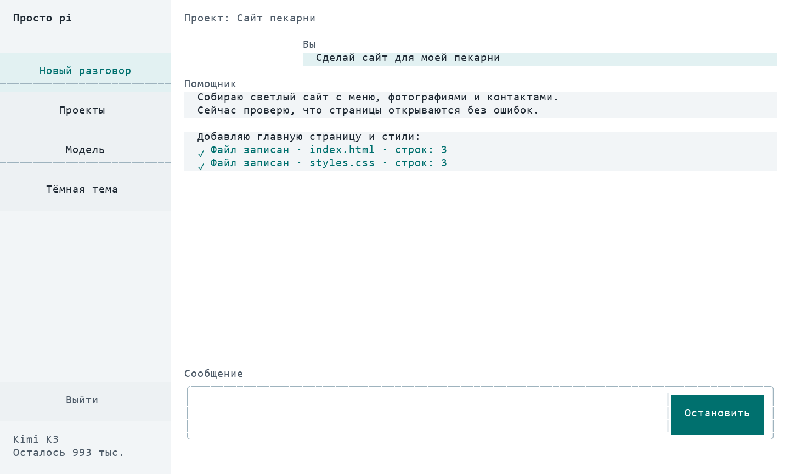
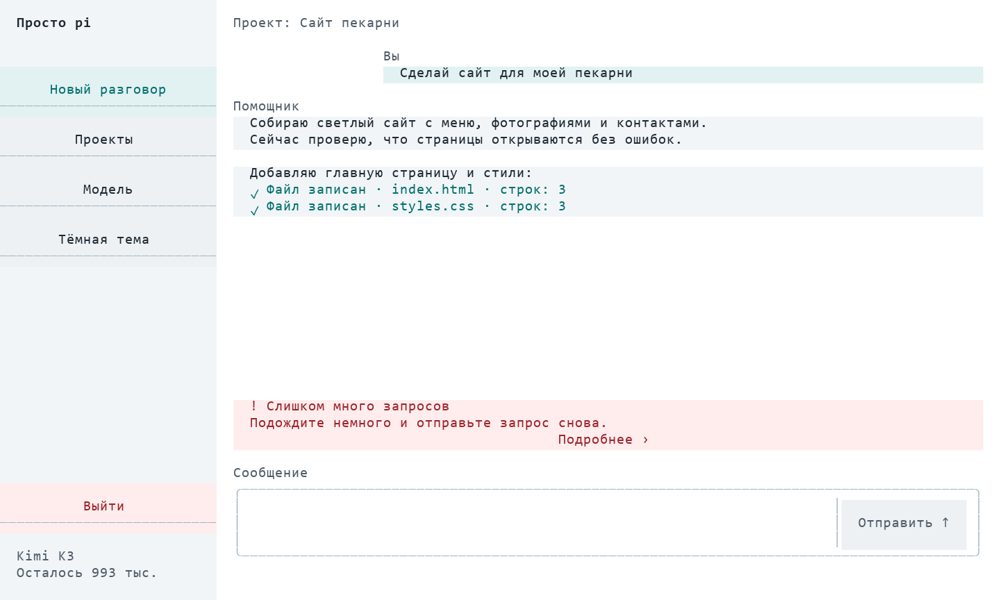
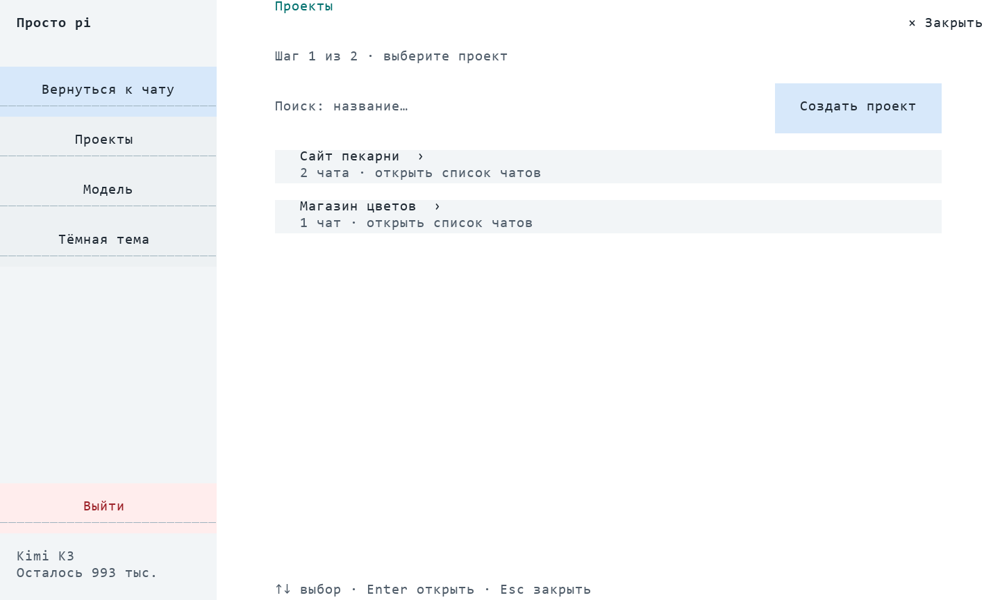
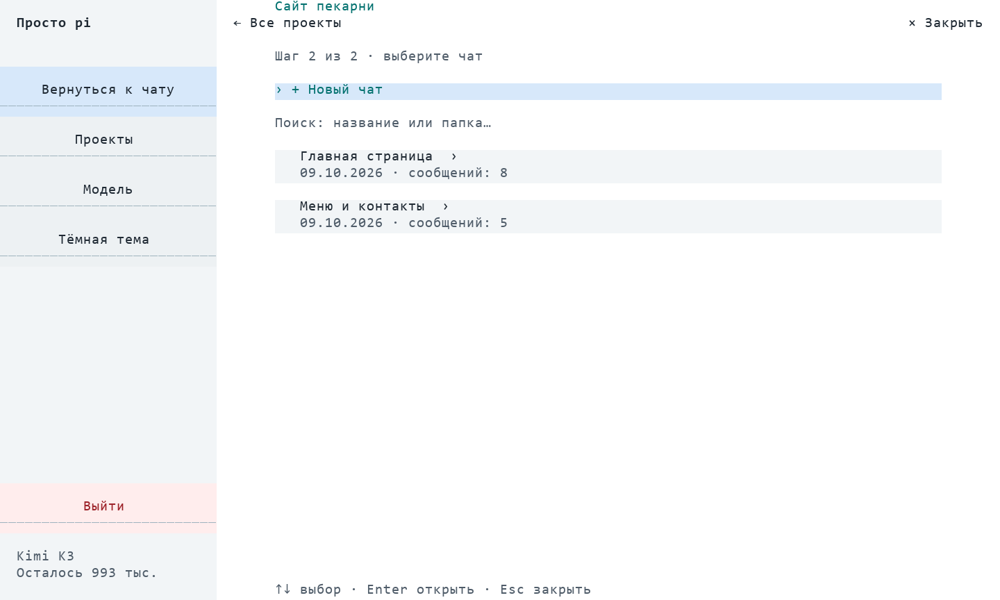
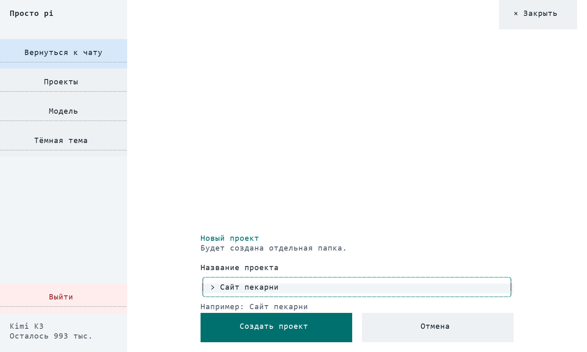

# Просто pi

При обычном запуске `pi` или с ярлыка AI DIY чат открывается в браузере по умолчанию. Оставьте терминал открытым, пока работаете. Через SSH и на компьютере без графической сессии чат работает в терминале. Для запуска только в терминале задайте переменную среды `PI_FRIENDLY_AUTO_WEB=0`.

## Установка

```sh
pi install git:github.com/slavamirniy/pi-friendly
```

Для установки нужен Node.js 20+ и pi 0.84.4. Команда одинакова на Windows, macOS и Linux. Настройки подключения к роутеру и API-ключ остаются локальными на каждом устройстве и не входят в пакет.

Обновление уже установленного пакета:

```sh
pi update git:github.com/slavamirniy/pi-friendly
```

После обновления перезапустите pi. Если расширение раньше вручную копировалось в `~/.pi/agent/extensions/pi-friendly`, оставьте только один способ установки: локальная копия и Git-пакет одновременно вызывают конфликт команд. Отдельный `llmsrouter-progress` больше не нужен — он встроен.

Удаление:

```sh
pi remove git:github.com/slavamirniy/pi-friendly
```

## Проекты

Проект — отдельная папка с файлами. Внутри проекта может быть несколько независимых чатов с общими файлами.

**Новый разговор** предлагает:

- **В текущем проекте** — новая переписка с теми же файлами.
- **Новый проект** — введите название, расширение создаст отдельную папку в ~/Documents/AI DIY Projects.
- **Выбрать проект** — открыть существующий проект или его чат.

**Проекты** показывает только явно созданные или добавленные проекты. Папка запуска pi и папки старых переписок не превращаются в проекты автоматически. **Создать проект** справа от поиска открывает форму названия в той же панели и создаёт отдельную папку. Импорт папок убран из интерфейса. Выберите проект — справа откроются его чаты. **← Все проекты** возвращает к списку, **+ Новый чат** начинает разговор в выбранном проекте.

Название нового проекта вводится в оформленной форме с кнопками **Создать проект** и **Отмена**. Ошибки названия показываются под полем; Tab переключает поле и кнопки, Enter подтверждает, Esc отменяет.

Проекты и чаты отображаются плоским списком без рамок карточек. У проекта видны путь и число чатов; текущий проект подписан. Действия вынесены над списком и остаются видны при поиске. Выбор выделен фоном; работают мышь, колесо, ↑↓, Tab и Enter.

Название текущего проекта видно над перепиской. Рабочую папку меняет штатный механизм переключения сессий pi: файловые инструменты, настройки и ресурсы загружаются для целевого проекта. Это разделение рабочих папок, а не файловая песочница: абсолютные пути остаются доступны инструментам.

При запуске из любой незарегистрированной папки первое обычное задание требует выбора проекта. Переписки вне проектов доступны через «Другие разговоры»; файлы и история автоматически не переносятся. При смене чата черновик переносится в новое поле ввода. Отмена выбора ничего не меняет.

Пустые проекты сохраняются в ~/.pi/agent/friendly-projects.jsonl, разговоры — в штатном хранилище pi. Совпадающее название нового проекта создаёт папку с числовым суффиксом, без перезаписи существующих файлов.

## Интерфейс

История и выбор модели открываются справа, левая навигация остаётся доступной. **× Закрыть** возвращает к чату; можно сразу переключиться в другой раздел слева. При переходе предыдущий раздел остаётся видимым до отрисовки следующего, без промежуточного экрана чата. Кнопки проектов центрированы; выбор модели открывается компактным меню над нижним селектором. Кнопки «Команды» нет: используйте / в поле ввода.

Чат использует доступную ширину справа от меню. Поле ввода и высокая кнопка отправки стоят рядом; короткие сообщения не окружены пустыми строками. Результаты действий с файлами сохраняются в истории: путь, статус и число записанных строк. Галочка появляется только после подтверждённого успешного результата инструмента. Превью из строк реального рендера с демонстрационными сообщениями (не снимок запущенного терминала):



- Слева — **Новый разговор**, **Проекты**, **Открыть в браузере**. Значок солнца/луны сверху переключает тему. Модель выбирается под полем сообщения через компактное меню. Внизу — баланс, **Пополнить баланс** и **Выйти**.
- **Отправить** имеет кликабельную область высотой три строки и становится **Выполнить** при вводе slash-команды и **Остановить** во время ответа.
- Проекты и чаты находятся на отдельных экранах. Поиск фильтрует текущий список.
- Служебный баннер расширений, reasoning и подробные логи инструментов скрыты в обычном чате. **Подробности** возвращают стандартный экран pi; кнопка сверху возвращает в чат.
- Действия с файлами отображаются в переписке. Отдельная нижняя панель «Работаю» убрана, чтобы оставить больше места чату.
- Подписи кнопок центрированы; основные кнопки имеют скруглённый контур и единые отступы.
- Ошибка отображается отдельной карточкой: понятная причина, следующий шаг и **Подробнее** с текстом сервиса. Поддержаны ошибки сети, доступа, квоты, ограничения частоты, контекста и сервера. Уведомления о прогрессе не скрывают ошибку.
- Остаток квоты — слева под моделью, другие статусы расширений — внизу.
- Светлая тема включена по умолчанию; выбор сохраняется в ~/.pi/agent/friendly-ui.json.

Введите / для кликабельного автодополнения. Выбор подставляет команду, которую можно дополнить аргументами и выполнить. Стрелки, Tab и Enter сохраняют штатное поведение. F2 — дополнительный способ открыть меню. Колесо прокручивает историю чата.

## Изображения

Попросите изображение прямо в чате — модель вызовет инструмент `generate_image`. Для ручной генерации нажмите значок изображения в поле ввода: чат заменится панелью генерации. Референс добавляется через пунктирный плюс: с компьютера или из сгенерированных. Модель фиксирована (`gpt-image-2.5`), выбираются пропорции и количество (до четырёх картинок).

Доступны пропорции `auto`, `1:1`, `3:2`, `2:3`, `16:9` и `9:16`. Картинки сохраняются в `generated/<чат>/` внутри проекта вместе с JSON-описанием, поэтому модель может открыть файл по относительному пути. Панель изображений открывается справа и сдвигает чат: картинки идут Pinterest-сеткой с бесконечной прокруткой, а внизу — референсы (до четырёх), поле запроса, пропорции и генерация. Референсы можно перетаскивать из галереи или чата, а также добавлять с компьютера. Нажатие на картинку в чате открывает эту панель. Генерация не ограничена таймаутом и расходует AI-кредиты.

## Совместимость

Проверено с pi 0.84.4 и llmsrouter-progress. Оболочка использует существующий редактор, сохраняя ввод, вставку, автодополнение файлов и обработчики отправки. Окна pi и других расширений открываются штатно; оболочка скрывается, пока они удерживают фокус.

Статусы footer и виджеты передаются в простой вид; для многострочных виджетов показывается последняя строка. Полный вывод доступен в техническом виде. Произвольные интерактивные виджеты других расширений могут требовать технического вида. Если другой плагин полностью заменяет редактор после этого расширения, порядок загрузки важен.

Минимум 44 столбца × 12 строк; для комфортной работы лучше 90 × 28 или больше. Нужен терминал с SGR mouse reporting и true color. Обычное выделение текста в поддерживаемых терминалах — с Shift.

Флаг --friendly-keep-footer сохраняет штатный footer другого расширения и отключает собственные slash-подсказки. Флаг --friendly-no-welcome оставлен для совместимости: стартового модального окна больше нет. RPC/JSON/print не меняются. Встроенные функции роутера используют локально настроенный ключ для запросов баланса, моделей и прогресса. Секреты не передаются в браузер и не входят в репозиторий.

## Разработка

```sh
node --test *.test.mjs
pi -e ./index.ts
node smoke.mjs /path/to/node_modules/@earendil-works/pi-coding-agent
node smoke-projects.mjs /path/to/node_modules/@earendil-works/pi-coding-agent
```

Тесты покрывают мышь, размеры окна, поиск, штатное выполнение команд, сторонние slash-подсказки, асинхронные гонки, методы редактора, историю, статусы, светлую/тёмную тему и скрытие reasoning. Smoke-проверка загружает расширение настоящим загрузчиком pi. Проверки не требуют запроса к платной модели.

## Дизайн

Использованы рекомендации [UI UX Pro Max](https://github.com/nextlevelbuilder/ui-ux-pro-max-skill): понятные подписи, заметный выбор, контраст и сохранение фокуса. Imagegen-концепты и промпт находятся в design/. Это эскизы, а не снимки реализации: в версии 0.4 кнопка команд убрана, разделы переключаются справа от постоянной навигации.

MIT.


### Превью состояний






Данные этих превью демонстрационные. Генерация: node design/preview.mjs /path/to/pi-package, затем python design/render_preview.py (Pillow, Windows fonts).

В открытых окнах справа сверху есть «Закрыть». Кнопка «Новый разговор» в боковой панели меняется на синюю «Вернуться к чату».

Кнопка «Выйти» недоступна во время ответа помощника. После завершения ответа она открывает подтверждение «Выйти / Отмена» поверх чата. Enter по умолчанию и Escape отменяют выход.

Отправка сообщений разрешена только в зарегистрированном проекте. Общая папка запуска и другие папки без проекта открывают выбор «Новый проект / Выбрать проект», сохраняя текст. Старые сообщения в общей папке не снимают это ограничение.

Форма названия нового проекта расположена внизу окна, рядом с привычным местом ввода сообщения.


### Голосовой ввод GigaAM

Встроен в расширение. При первом запуске pi в фоне подготавливается отдельная среда и скачивается GigaAM v3 E2E CTC INT8: **224 893 347 байт (224,9 МБ / 214,5 МиБ)** плюс словарь и конфигурация. Слева отображаются этап и процент загрузки. Проценты установки Python/зависимостей не выдумываются: эти этапы показываются названием. Незавершённая загрузка продолжается с `.part`, файлы проверяются SHA-256. Подготовка не блокирует чат.

Нажмите квадратную кнопку **🎤** справа внутри поля сообщения, перед «Отправить», говорите, затем нажмите **Enter** или **■** на том же месте. Полоски отражают громкость входящего звука, рядом отображается длительность. Запись и процент распознавания показываются только внутри поля сообщения; левая панель используется только для подготовки и загрузки модели. Поддерживается диктовка на одну, две и более минут (до 10 минут за запись). Запись разбивается в тихих местах на фрагменты до 20 секунд; прогресс распознавания — доля обработанного аудио, а не таймер. После завершения весь текст добавляется к черновику. Отправка — только пользователем. Во время записи Enter запускает распознавание; во время распознавания Enter не отправляет сообщение. Кнопка отправки недоступна, пока диктовка не обработана.

Микрофон включается только по нажатию, аудио хранится в памяти и не отправляется на сервер. При переключении чата запись отменяется; поздний результат не вставляется в другой проект. При закрытии pi процесс голоса завершается. После первоначальной загрузки распознавание работает без интернета; модель общая для всех проектов, не скачивается в их папки.

Среда: Windows x64, Linux x64 (glibc 2.28+), macOS 13+ Intel/Apple Silicon. Используется CPU ONNX Runtime и miniaudio со встроенным аудиодвижком: CUDA, PyTorch, FFmpeg и системный Python не нужны. В macOS может понадобиться разрешить микрофон для приложения терминала; в Linux нужен работающий звуковой сервер/устройство. На неподдерживаемой архитектуре чат остаётся рабочим, а голос показывает понятную ошибку.

Данные голоса находятся в `~/.pi/agent/friendly-voice`: автоматически загружаемый Python, изолированное окружение и модель. Дополнительное место занимает среда выполнения и кэш установки. Это внутренние компоненты плагина, без отдельного приложения и без изменения системного PATH. Ошибку загрузки можно повторить кнопкой **Повторить**.

Источники: [GigaAM](https://github.com/salute-developers/GigaAM), [ONNX-конверсия Ilya Stupakov](https://huggingface.co/istupakov/gigaam-v3-onnx), [onnx-asr](https://github.com/istupakov/onnx-asr), [miniaudio](https://github.com/irmen/pyminiaudio), [uv](https://github.com/astral-sh/uv). Версия ONNX-модели закреплена по commit и SHA-256, установщик uv — по версии и SHA-256; зависимости Python закреплены в `voice-setup.mjs`.

Проверено на Windows: реальный запуск ONNX-модели, 120 секунд тестовой речи с пофрагментным прогрессом, сохранение черновика, отмена при смене чата и завершение worker. В текущем окружении macOS/Linux не запускались; для них проверены пути запуска и наличие бинарных зависимостей. Микрофон пользователя в автоматической проверке не записывался.

Значок микрофона виден и во время подготовки: нажатие показывает подсказку «Для голосового ввода дождитесь загрузки голосовой модели» со стрелкой влево и подсвечивает блок загрузки на 3 секунды. Запись до готовности модели не начинается.

Во время записи внутри поля ввода показана история громкости: новые значения появляются справа и сдвигаются влево, тишина обозначается точками. Enter завершает запись и запускает распознавание; отправка текста остаётся ручной.

При записи дорожка из тонких вертикальных символов заменяет черновик без увеличения высоты поля. Черновик сохраняется и снова отображается после распознавания.

Звуковая дорожка рисуется точками Braille: в стандартном поле из трёх строк доступны 12 высот столбиков с шагом в одну точку. Это точечная терминальная графика; форма точек зависит от шрифта, но высота задаётся числом точек, а не толщиной символа.

Обычная громкость рисуется компактнее; максимальная высота остаётся для пиков. Нечётные высоты отклоняются от центра не более чем на половину точки.

Правый клик внутри поля ввода открывает «Вставить» и «Удалить всё». Буфер читается только после выбора вставки; текст вставляется в позицию курсора без отправки. Включён нативный мигающий курсор терминала. Для нативного выделения и копирования в Windows Terminal удерживайте Shift при перетаскивании мыши. Такое выделение относится к терминалу, а не к редактированию части черновика.

### Выделение и меню поля ввода

В поле ввода зажмите левую кнопку мыши и проведите по тексту: Shift не нужен. Правый клик открывает компактное меню «Копировать» (при выделении), «Вставить», «Удалить всё». Ctrl+C копирует выделенный текст; ввод или вставка заменяет выделение. Выделение реализовано внутри расширения для поля ввода; выделение истории чата по-прежнему зависит от терминала.


## Веб-интерфейс

В боковой панели pi нажмите **Открыть в браузере**. В небольшом окне доступна отдельная кнопка **Веб-интерфейс**; можно также ввести `/friendly web`.

Локальный сервер работает внутри расширения. Пока открыт веб-интерфейс, консоль показывает «Сейчас идёт работа в веб-интерфейсе» и не принимает команды. Enter в консоли повторно открывает браузер, если вкладку закрыли. **Выйти** в браузере после подтверждения завершает веб-сервер, дочерний процесс и сам pi; во время работы выход заблокирован. Браузер может запретить автоматическое закрытие вкладки — тогда её нужно закрыть вручную.

- Светлая и тёмная темы в сдержанном стиле Vercel/Kontur: белый холст, тонкие тени вместо рамок, Geist и Geist Mono. На узких экранах боковая панель сжимается до иконок.
- Слева — **Проекты**, быстрый список последних проектов (текущий выделен синим) и чаты текущего проекта. В списке есть пункт **«Создать чат»** с пунктирной рамкой; создание также доступно кнопкой **Новый чат** на экране чатов проекта, а **Новый проект** — на экране проектов.
- Если уйти из чата во время ответа, над проектами появляется заметная кнопка **«Вернуться к чату»** с индикатором идущего ответа. Она работает и во время генерации.
- История чата сначала читается напрямую из файла сессии и показывается сразу; процесс pi и RPC подключаются в фоне. Отправка блокируется только на время этого подключения, а не на всё открытие чата.
- Новый чат получает короткое название по первому сообщению. Название генерирует текущая модель отдельным небольшим запросом; при ошибке, таймауте, пустом или невалидном ответе используется локальный fallback из текста сообщения. Служебные команды и уже названные чаты не переименовываются.
- Очередь сообщений свёрнутая, редактируется на месте и поддерживает отправку сейчас или всей очереди. Отправка сейчас прерывает текущий ответ и сразу запускает выбранное сообщение; остальные остаются в очереди.
- При наведении на чат в сайдбаре появляются архивирование и удаление. Удаление подтверждается; архив переносит файл сессии в подпапку `archived`. Кнопка **Архив** в разделе чатов и на экране проекта открывает список архивных чатов, где их можно восстановить или удалить.
- Окно выбора папки содержит крупные быстрые переходы только для существующих папок: домашняя, документы, рабочий стол, загрузки и проекты AI DIY.
- Вложения выбираются системным диалогом и передаются агенту как абсолютные пути: файлы не копируются в папку проекта. В сообщении они показываются отдельными карточками с типом и размером, а не служебным текстом; до отправки вложение можно открепить. Кнопки вложения и голосового ввода доступны и во время ответа — текст можно добавить в очередь.
- Файлы можно перетащить прямо в окно чата. Браузер не отдаёт исходный путь при drag&drop, поэтому такие файлы сохраняются во временную папку `~/.pi/agent/friendly-drop` и прикрепляются путём оттуда, не попадая в проект.
- Во время ответа под полем ввода показывается компактная панель: текущий фрагмент текста, время и остаток квоты. Очередь остаётся над полем ввода.
- Проекты и история берутся из существующей конфигурации. Новый проект получает отдельную папку; каждый его чат работает в ней.
- Текущий разговор консоли подключается к тому же агенту. Другие чаты запускаются через установленный pi в RPC-режиме, с его настройками, авторизацией, инструментами и расширениями. Одновременно активен только один чат.
- Пока идёт ответ, новые сообщения можно отправлять в очередь. Enter при работающем агенте добавляет сообщение в очередь; **Остановить** прерывает ответ и возвращает очередь в поле ввода. Отдельная кнопка **+** ставит в очередь без остановки.
- Кнопка **Изменить** у сообщения пользователя создаёт новую ветку-чат с исправленным текстом и сразу отправляет его. **Ветка отсюда** создаёт новый чат без изменения текста. Старый чат остаётся в списке слева.
- Загрузка всегда видна: тонкая полоса прогресса, подпись действия, skeleton-строки при открытии списка или чата, отдельный индикатор размышления и потокового ответа. Ошибки соединения показываются вместо постоянного статуса «на этом компьютере».
- Потоковый ответ, остановка, карточки файлов и действий, понятные ошибки; размышления модели доступны в сворачиваемом блоке и открываются независимо для каждого сообщения. Подряд идущие сообщения ассистента показываются под одной аватаркой с тонким разделителем. Во время генерации текста в конце ответа мигает курсор; прерванный ответ помечается статичной строкой без индикатора загрузки.
- Индикатор генерации и время находятся тонкой строкой под полем ввода; очередь расположена над полем. Квота остаётся в сайдбаре, а не в блоке генерации.
- Нативное поле браузера: выделение, контекстное меню, копирование, вставка, черновики между экранами. Enter отправляет; Shift+Enter добавляет строку.
- Микрофон использует уже работающий локальный GigaAM и микрофон компьютера с pi. Повторный клик или Enter заканчивает запись; распознанный текст остаётся черновиком. Загрузка модели показывается слева, распознавание — в поле ввода.
- Текстовые статусы и виджеты расширений, а также стандартные запросы выбора, подтверждения и ввода передаются в браузер. Произвольные терминальные компоненты `ui.custom()` требуют консоль и не превращаются автоматически в веб-компоненты.

Сервер слушает только `127.0.0.1` на свободном порту. Доступ к API требует временного ключа, который кнопка запуска передаёт браузеру; затем используется HttpOnly-cookie. Запросы с чужих Origin/Host отклоняются. Это локальный интерфейс, не публичный сайт.

Веб-интерфейс рассчитан на один активный чат: несколько вкладок показывают одну сессию. Переключение чата во время ответа блокируется, чтобы не потерять поток. Вложения и встроенный предпросмотр созданных сайтов пока не добавлены.

### Проверка веб-версии

`node --test *.test.mjs` проверяет маршруты, доступ, проекты, события и мост консольной сессии.

`node web-smoke.mjs <папка установленного pi>` проверяет настоящий RPC без запроса модели. Флаг `--prompt` дополнительно запускает короткий запрос модели и проверяет запись файла в отдельном временном проекте.

`node web-preview.mjs` запускает **демонстрацию с тестовыми данными**, без моделей и без доступа к пользовательским проектам.

### Навигация и настройки

Последние открытые проекты поднимаются наверх; порядок сохраняется в реестре проектов. В списках проектов и чатов поиск скрыт за кнопкой «Поиск»; в консоли также Ctrl+F, Escape закрывает поиск и очищает фильтр. При создании и переключении чата показана загрузка; открытие списка проектов не заменяет экран вспышкой загрузки.

Выбор модели общий для проектов и интерфейсов, сохраняется в `~/.pi/agent/friendly-model.json`. При открытии применяется последняя выбранная доступная модель. Если её больше нет в конфигурации, используется модель pi; сохранённая настройка не удаляется.

Карточки действий показывают подготовку, выполнение, успех, ошибку и остановку. Раскройте карточку для пути файла, команды или результата инструмента (до 16 000 последних символов). Число токенов показывается только по фактическим данным модели; проценты генерации не выдумываются.

Ошибки ответа показываются после `agent_settled`, когда pi завершил автоматические повторы. Временные ошибки связи не выводятся во время работы. Окончательная ошибка раскрывается кнопкой «Подробнее» прямо в текущем экране, в обоих интерфейсах.

В веб-списке проектов «Выбрать папку» открывает системный диалог на компьютере с pi и подключает выбранную папку без копирования файлов. На Windows/macOS используется встроенный диалог; на Linux нужен zenity или kdialog. Квадратная лупа и кнопка создания объединены без зазора. Пока pi повторяет запрос, интерфейс показывает только индикатор работы; обычные подсказки интерфейса не оформляются как ошибки модели.


## Баланс и оплата (0.11)

«Баланс и пополнение» доступно в боковой панели веба; в терминале нажмите отдельную кнопку «Пополнить баланс» под остатком токенов. Пакеты и цены приходят с `/router/purchases/offers`. Отдельные подтверждения оферты и обработки ПД обязательны и не отмечаются заранее. Веб отслеживает заказ после оплаты; терминал обновляет баланс в фоне. Карточные данные вводятся только в CloudPayments.

Недействительный ключ ведёт в Telegram за обновлением доступа, истёкший пакет и нулевой баланс — к пополнению. Временные сетевые ошибки не объявляются истечением ключа. Подтверждения документов записываются локально в `purchase-consents.jsonl` без API-ключа; это не замена серверному юридическому аудиту.

Для реальных платежей нужны развёрнутые purchase endpoints роутера и настройки CloudPayments. Пока они не подключены, интерфейс честно сообщает о недоступности пополнения. Локальные проверки оплаты используют имитацию сервиса и не списывают деньги.

## Встроенный роутер

Начиная с 0.12, прогресс, квота и обновление моделей из pi-router-progress встроены в пакет. Отдельное расширение llmsrouter-progress следует удалить из списка загрузки, чтобы не было повторных подписок. Веб-интерфейс получает предварительный текст напрямую из потока роутера; при повторе запроса старый фрагмент заменяется. Сбой потока прогресса не прерывает генерацию.
